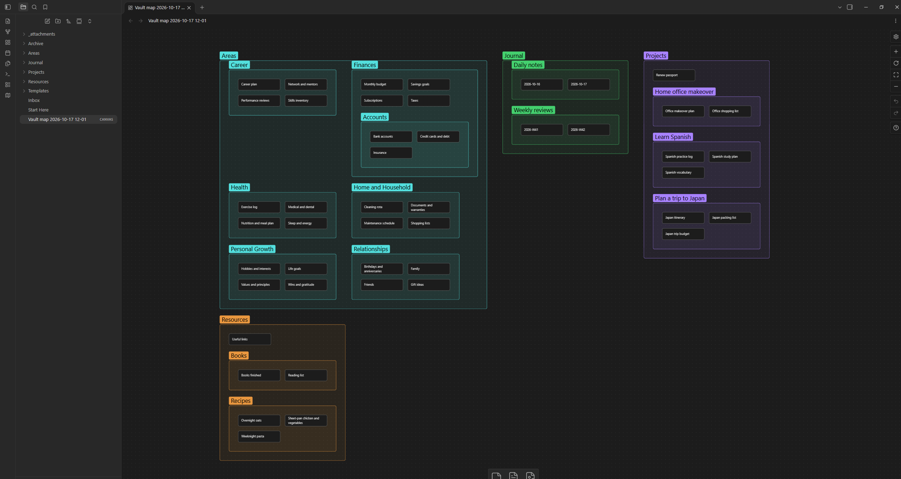

# Folder Note Map
> Map your whole vault on a canvas in one click.


Folder Note Map reads your vault and generates a canvas where every folder that has a [folder note](#what-counts-as-a-folder-note) becomes a **group**, containing its notes as cards and its subfolders as nested groups. It gives you a bird's-eye view of what you have, so you can decide what to reorganize, merge or remove, and then change it by hand.

The cards are ordinary **canvas notes** (text cards). They live only inside the canvas, so generating a map **never creates, changes or moves any note in your vault**, it only creates one new canvas with the creation date (yyyy-mm-dd hh-mm format).

Rename cards, drag them between groups, add edges and colors, or delete the whole map.
One way to use it is to generate two folder note maps (if both are created in the same minute, due to non-destructive saving, it won't overwrite but add a numeric suffix), organize one and let the other one unchanged. This way one can follow the changes made afterwards.



## Usage
Click the **map** icon in the ribbon, or run **Generate vault map canvas** from the command palette. The map is created and opened in a new tab.

## What ends up on the map

| In your vault | On the map |
| --- | --- |
| A folder with a folder note | A group labeled with the folder name |
| Notes inside that folder | Cards (canvas notes) inside the group |
| The folder note itself | Represented by the group. An extra card for it is optional |
| Subfolders with folder notes | Groups nested inside the parent group |
| A folder **without** a folder note | Not shown, and its own files are never shown (unless they are folder notes that aren't hidden) |
| A folder note with `map-as: note` | A single card for that folder. The folder's contents are not shown |
| A folder note with `map-as: hide` | Nothing. The folder and everything in it is left off |


For example:

```
Areas/
  Areas.md <- folder note, so Areas is a group
  health.md <- card "health"
  Archive/
    Archive.md <- has map-as: hide, so left off the map
Projects/ <- no folder note, so its own files are skipped
  Alpha/
    Alpha.md <- folder note, so Alpha is a group
    notes.md <- card "notes"
```

This produces an **Areas** group with one card, and an **Alpha** group with one card. By default the plugin looks inside `Projects` for folders that do have a folder note; you can change that in settings (`Folders without a folder note`).


### Showing a folder as a plain note
Sometimes a folder is just a container for one note and you don't want a whole group for it. Add a property to its folder note:

```yaml
---
map-as: note
---
```
The folder appears as one card, and the files inside it are left off the map. Use `map-as: hide` to leave a folder off the map entirely, for example an archive. The property name is configurable (or can be switched off) in settings.


### What counts as a folder note
You choose the convention in settings:
- **Inside the folder, same name:** `Folder/Folder.md` (the default)
- **Inside the folder, index file:** `Folder/index.md`. The file name is configurable.
- **Next to the folder, same name:** `Parent/Folder.md` beside `Parent/Folder/`


### Tip: keep a "before" map
Keep one generated map untouched as your baseline, and reorganize a copy of it: move cards between groups, rename them, merge or delete them. Would suggest marking changes so it can be followed. Restructure your vault, generate a fresh map, and compare it with the original to check your changes.
- Create a copy either via `Make a copy of the current file` (preferred) or via our very own `Folder Note Map: Generate vault map canvas` plugin command.


## Settings

| Setting | What it does | Default |
| --- | --- | --- |
| Folder note style | Which convention marks a folder note | Inside the folder, same name |
| Mapping property | The property that switches a folder to `note` or `hide` | `map-as` |
| Folders without a folder note | Look inside them for folders that have a folder note, or skip them completely | Look inside |
| Card for the folder note itself | Adds the folder note as a card inside its group | Off |
| Include notes in the vault root | Adds cards for notes that aren't in any folder | Off |
| Include other file types | Adds cards for images, PDFs and other non-note files, shown with their full file name | Off |
| Color groups by top-level folder | One canvas color per top-level area | On |
| Card content | **Note name only:** plain text, easy to rewrite while you plan. **Link to the note:** a clickable `[[link]]` | Note name only |
| Card width / height | Size of each card | 220 x 60 |
| Output folder / File name | Where the map is saved and what it's called | Vault root, "Vault map" |
| Overwrite the previous map | Off creates a new timestamped canvas each time, so manual edits are never lost | Off |


## Good to know
- Cards are lightweight text, so even large vaults stay responsive. To keep a very large map readable, mark busy folders with `map-as: note` or `map-as: hide`.
- Notes and groups are laid out alphabetically, so the map looks the same each time you generate it.
- The map is a snapshot. It does not update when your vault changes; generate a new one when you want a fresh view.
- The plugin only uses Obsidian's public API and makes no network requests.


## Installation

**From the community plugin directory** (once approved): Settings → Community plugins → Browse → search for **Folder Note Map**.

**Manually:**
1. Download `main.js` and `manifest.json` from the [latest release](https://github.com/goncasCartaxana/folder-note-map/releases/latest).
2. Put both in `<your vault>/.obsidian/plugins/folder-note-map/`.
3. Enable **Folder Note Map** under Settings → Community plugins.

## Development
```bash
npm install      # Run to install required external packages
npm run dev      # rebuild on every change
npm run build    # type-check and produce a minified main.js
````
- `src/vaultModel.ts` reads the vault and decides what appears on the map.
- `src/layout.ts` positions everything and writes the canvas JSON. It has no Obsidian dependency.
- `src/main.ts` and `src/settingsTab.ts` hold the plugin and its settings.


### Releasing
1. Run `npm version patch` (or `minor` / `major`). This updates the version in `package.json`, `manifest.json` and `versions.json`, then commits and tags it.
2. Run `git push --follow-tags`.
3. The [release workflow](.github/workflows/release.yml) builds the plugin and publishes a GitHub release with `main.js` and `manifest.json`.

The tag must exactly match the `version` in `manifest.json`, with no leading `v`.

## License

[MIT](LICENSE)

